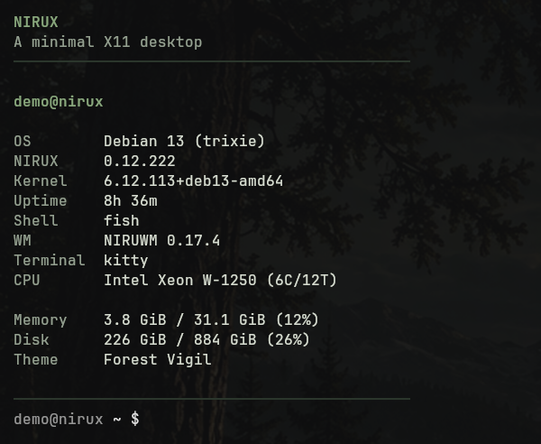

# NIRUFETCH

Fast, local terminal system summary in the NIRUX visual style.

**Status: beta** · Part of the [NIRUX](https://github.com/nirucon/nirux) suite · [MIT License](LICENSE)



## About

NIRUFETCH is a terminal system fetch for NIRUX. It reads `/proc`, `/sys`,
`/etc`, the NIRUX generation manifest and the NIRUWM theme; there is no network,
daemon or background service, and it starts no other process. A run takes a few
milliseconds. NIRU Launcher's Health view uses its JSON output.

## Features

- A narrow, aligned NIRUX system summary (a 44-column header) that adapts to
  tiled terminals: values use the real terminal width and are cut only when they
  still do not fit.
- `--compact` for small windows, `--classic` for the original large ASCII logo
  (dropped automatically below 60 columns), `--full` for every field with
  wrapped, untrimmed values.
- Colours follow the active NIRUX theme, including your own themes; truecolor,
  256 or 16 colours depending on the terminal.
- NIRUX and NIRUWM versions from the installed generation, the same versions
  `nirux --version` and `nirux update` report.
- `--json` with every `--full` field, for scripts, the launcher and bug reports.

## Requirements

- Linux (Debian, Arch and Void glibc, x86_64). The only Rust dependency is
  `libc`; nothing else is needed at run time.
- NIRUX is optional: without it, the NIRUX fields are skipped.

## Installation

### With NIRUX

NIRUFETCH is a core component: `nirux install` and `nirux update` install and
update it from the pinned manifest. The standalone installer refuses to touch a
NIRUX-managed copy.

### Standalone

```sh
git clone https://github.com/nirucon/nirufetch
cd nirufetch
./install.sh            # download the pinned release, verify SHA256SUMS, install to ~/.local/bin
./install.sh --build    # or build from this checkout with cargo
```

`NIRUFETCH_PREFIX` (or `NIRU_PREFIX`) changes the prefix (default `~/.local`).

## Usage

```sh
nirufetch              # default NIRUX summary
nirufetch --compact    # smaller windows
nirufetch --classic    # large ASCII logo
nirufetch --full       # every field, values wrapped
nirufetch --json       # every --full field as JSON
nirufetch --no-logo
nirufetch --plain      # no colour (also --no-color, or NO_COLOR set)
nirufetch --version
nirufetch --help
```

Colour is off when stdout is not a terminal.

### Fields

- **NIRUX** and **WM** (for example `NIRUWM 0.17.4`) come from the installed
  generation's `~/.local/share/nirux/current/manifest` (or
  `$NIRUX_PREFIX/share/nirux`).
- **Terminal** is found by walking the parent processes up to the first known
  terminal emulator (kitty, alacritty, foot, wezterm, xterm, st, urxvt,
  gnome-terminal, konsole, ghostty and more), then `$TERM_PROGRAM`, then
  `$TERM`.
- **CPU** drops vendor noise ("(R)", "CPU @ 3.30GHz", "w/ Radeon 890M") and
  adds the core/thread count (`(6C/12T)`).
- `--full` adds GPU (names from `pci.ids` when installed), connected displays
  with their preferred mode, battery, swap, packages (dpkg, pacman and xbps
  databases, read as files), locale, load, the selected NIRUX extras with the
  versions the installed generation pins, and the theme id. Fields whose source
  is missing are skipped.

## Configuration

There is no configuration file. The theme follows `theme` in
`~/.config/niruwm/config.toml`: Noir, Nord, Satie, Carl Larsson, Forest Vigil,
Blood of Urdr, Root and Stone, Blue Horizon, The Norns, Winter Nights, or your
own `~/.config/niruwm/themes/NAME.toml`, whose name and colours are used.
Truecolor is used when `COLORTERM` is `truecolor`/`24bit` or the terminal is
known to support it; otherwise the palette falls back to 256 or 16 colours.

## Files and paths

| Path | Purpose |
|---|---|
| `~/.local/bin/nirufetch` | The program |
| `~/.local/share/nirux/current/manifest` | Installed NIRUX generation (read) |
| `~/.config/niruwm/config.toml`, `~/.config/niruwm/themes/` | Active theme (read) |

## Troubleshooting

- **No NIRUX or WM line:** no NIRUX generation was found; set `NIRUX_PREFIX` if
  NIRUX is installed under another prefix.
- **Wrong colours:** set `COLORTERM=truecolor` in a terminal that supports it,
  or use `--plain`.
- **Values are cut:** use `--full` to wrap them, or `--compact` in a narrow
  window.

## Uninstall

With NIRUX, NIRUFETCH is removed by `nirux uninstall`. A standalone copy:

```sh
./install.sh --uninstall
```

## Building from source

```sh
cargo test --locked
cargo build --release --locked
sh tests/smoke.sh target/release/nirufetch
```

Rust 1.85 or newer. `NIRUFETCH_ROOT` points the `/proc`, `/sys`, `/etc` and
`/var` reads at another tree (for tests).

## Status, disclaimer and how it's made

**Status: beta.** It is small and does one thing; the field list still grows now
and then.

NIRUX and every niru* project are made by me, Nicklas Rudolfsson
([@nirucon](https://github.com/nirucon)), for me. They are tailored to my own
needs, preferences and workflows, on my own machines. If they fit yours too,
that's a nice bonus.

- **Free and open source.** Anyone is free to use, study, change and share
  it under the [MIT License](LICENSE).
- **No guarantees.** There is no warranty of any kind. Use it at your own
  risk, read what you install and keep backups of anything that matters.
- **How it's made.** Some of these projects I built from scratch by hand. In
  more recent releases I have used Claude, Anthropic's AI, to do much of the
  heavy lifting under my direction: I decide what to build and how it should
  behave, and I test it on my own machines. It saves me a lot of time, and
  the result is quite OK.
- **Alpha, beta, dev, and maybe forever.** Most things here are alpha, beta
  or dev, and may stay that way. Maybe one day there will be a real stable
  release, but given how fast development moves, and how I am as a person,
  maybe never :)

| Label | Meaning |
|---|---|
| dev | Under active construction; may not build, install or work yet. |
| alpha | Works on my machines, but incomplete or rough; expect breaking changes. |
| beta | In daily use on my machines and mostly complete; rough edges remain. |

## License

MIT License, see [LICENSE](LICENSE). Copyright (c) 2026 Nicklas Rudolfsson.
